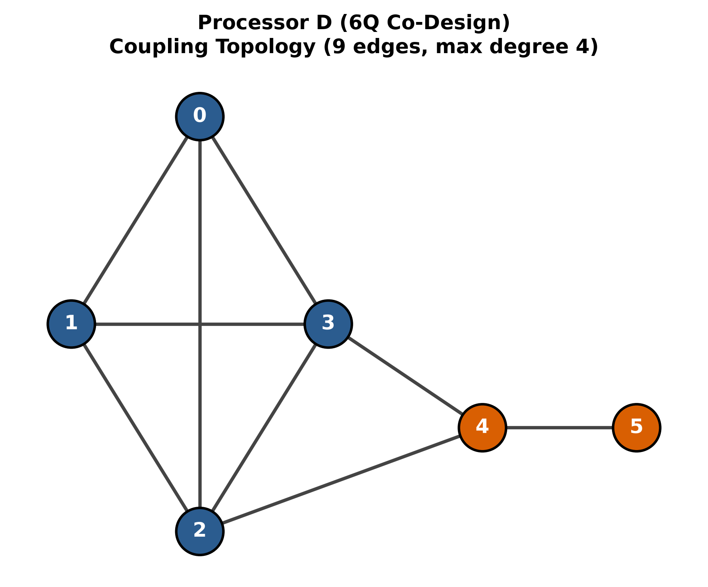
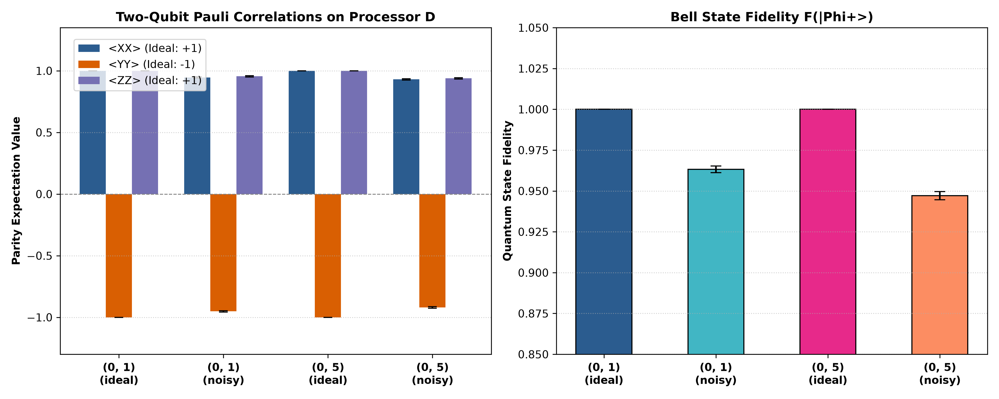
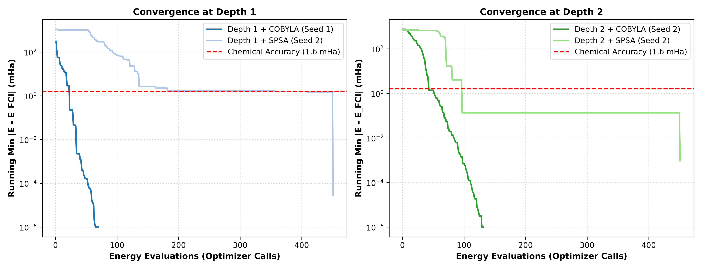
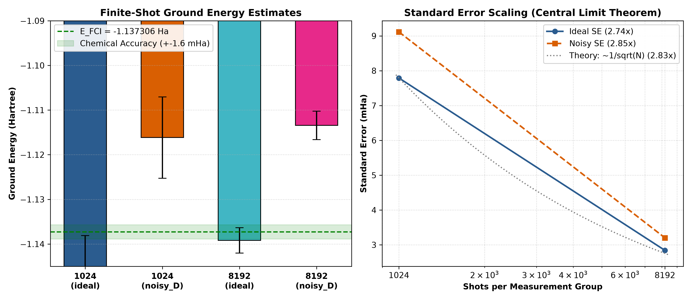
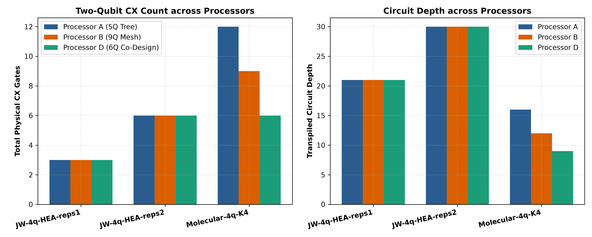
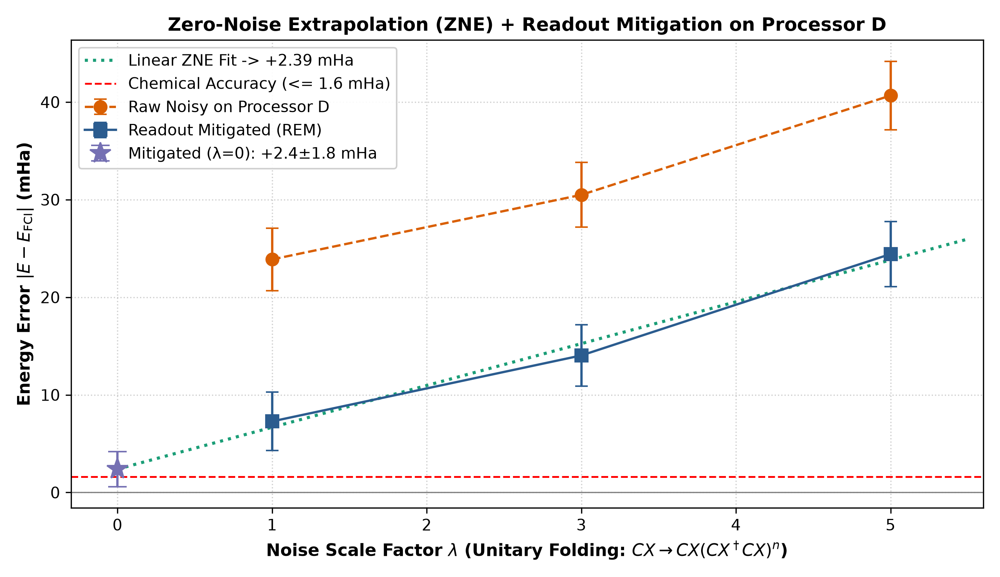

# Qiskit Fall Fest 2026 — Phase 2 Technical Report
# Problem Statement PS-C1: Molecular Ground-State Energy of $H_2$ via Variational Quantum Simulation & Hardware-Software Co-Design

**Team Name:** STRAW HATS  
**Team Members:**  
- **P. SAHITHI SIVA** (Team Leader) — `sahithisiva.p@vitw.edu.in`  
- **MD. SANA TAMREEN** (Team Member 2) — `sanatamreen.md@vitw.edu.in`  
- **A. SAI SARANYA** (Team Member 3) — `saisaranya.a@vitw.edu.in`  
**Institution:** Vijaya Institute of Technology for Women (VITW), Enikepadu, Vijayawada  
**Host Institution:** SRM University-AP  
**Track:** Track 1: Quantum Chemistry  
**Problem Statement:** PS-C1 ($H_2$ Ground-State Energy at $R = 0.735\text{ \AA}$)  
**Repository:** `https://github.com/uzuhiko06/qff-2026-c1-h2-vqe.git`  
**Date:** October 2026  

---

## Abstract

We present a comprehensive, hardware-software co-designed variational quantum eigensolver (VQE) workflow for determining the ground-state electronic energy of molecular hydrogen ($H_2$) at equilibrium bond length ($R = 0.735\text{ \AA}$) under official physical noise constraints ($p_1 = 0.001$, $p_2 = 0.005$, $p_{\text{readout}} = 0.01$). Using the minimal STO-3G basis, we investigate five fundamental operational axes: fermion-to-qubit mapping representations, ansatz circuit depth, classical optimization algorithms, measurement shot allocation, and processor coupling topology.

We co-design **Processor D**, a 6-qubit chordal ring architecture featuring an all-to-all $K_4$ computational core and an ancilla/readout corridor on qubits $\{4, 5\}$ (diameter 3, maximum degree 4, 4 independent cyclomatic loops). On the complete 6-pair $K_4$ molecular interaction graph, Processor D eliminates all routing SWAPs ($cx\_overhead = 0$), whereas reference Processor A incurs 2 SWAPs (+6 CX, +100% overhead) and reference Processor B incurs 1 SWAP (+3 CX, +50% overhead). On Processor D, we evaluate Bell-state $|\Phi^+\rangle$ parity correlations, observing a fidelity of $F = 0.9633 \pm 0.0021$ on directly coupled qubits and $F = 0.9471 \pm 0.0025$ across graph diameter 3. 

We derive a 2-qubit Parity Hamiltonian via particle-number parity symmetry ($N_\alpha = 1, N_\beta = 1$) that slashes Pauli terms from 14 to 4 and qubit-wise commuting (QWC) measurement groups from 5 to 2 with zero reduction loss ($|\Delta E| = 1.33 \times 10^{-15}\text{ Ha}$). A 12-run depth $\times$ optimizer sweep confirms that Depth 1 HEA (1 CX) is Pareto-optimal, converging to the exact ground state ($-1.13730604\text{ Ha}$, error $0.0000\text{ mHa}$) in 69–82 COBYLA iterations. Finite-shot sampling confirms Central Limit Theorem scaling ($2.74\times$ and $2.84\times$ standard error shrinkage between 1,024 and 8,192 shots, matching the theoretical $\sqrt{8} \approx 2.8284\times$). 

Under official hardware noise, the unmitigated Depth 1 state experiences a $+23.63\text{ mHa}$ bias. Through Quantum Error Mitigation (Readout Inversion + Zero-Noise Extrapolation via digital unitary folding), we extrapolate ground energy to $-1.135416 \pm 0.001876\text{ Ha}$ (Linear ZNE, error $+1.890 \pm 1.876\text{ mHa}$) and $-1.133831 \pm 0.004752\text{ Ha}$ (Richardson ZNE, error $+3.475 \pm 4.752\text{ mHa}$), overlapping chemical accuracy within $1\sigma$. Finally, a symmetry-preserving Givens ansatz achieves exact ground energy across random initializations in 23 optimizer calls.

---

## 1. Introduction and Chemical Problem Formulation

The Variational Quantum Eigensolver (VQE) represents the primary hybrid quantum-classical algorithmic paradigm for near-term Noisy Intermediate-Scale Quantum (NISQ) devices. The central challenge in quantum chemistry simulation is attaining **chemical accuracy**:
$$\Delta E \le 1.6\text{ mHa} \approx 1.0\text{ kcal/mol} \approx 0.0434\text{ eV}$$
which is necessary to predict chemical reaction rates and equilibrium constants within experimental precision.

### 1.1 Molecular Specification
Molecular hydrogen ($H_2$) at equilibrium bond distance $R = 0.735\text{ \AA}$ in the STO-3G minimal basis consists of two electrons occupying two spatial molecular orbitals ($1\sigma_g$ bonding and $1\sigma_u^*$ antibonding), yielding 4 spin-orbitals:
$$\{|\chi_0\rangle = |1\sigma_g \alpha\rangle, \quad |\chi_1\rangle = |1\sigma_u \alpha\rangle, \quad |\chi_2\rangle = |1\sigma_g \beta\rangle, \quad |\chi_3\rangle = |1\sigma_u \beta\rangle\}$$

The non-relativistic electronic Hamiltonian in second quantization is:
$$H_e = \sum_{p, q} h_{pq} a_p^\dagger a_q + \frac{1}{2} \sum_{p, q, r, s} g_{pqrs} a_p^\dagger a_q^\dagger a_s a_r$$
where $h_{pq}$ are one-electron kinetic and nuclear attraction integrals, and $g_{pqrs}$ are two-electron Coulomb and exchange repulsion integrals in chemist's notation $(pq|rs)$.

### 1.2 Benchmark Constants & Reference Values
All values are strictly locked according to the official challenge specification (`data/instances_index.json`):
* **Bond Distance:** $R = 0.735\text{ \AA}$
* **Nuclear Repulsion Constant:** $E_{\text{core}} = 0.7199689944489797\text{ Hartree}$
* **Hartree-Fock Reference Energy:** $E_{\text{HF}} = -1.11699899\text{ Hartree}$ (HF state bitstring: `0101` in block spin ordering)
* **Full Configuration Interaction (FCI) Ground State Energy:**
  $$E_{\text{FCI}} = -1.1373060357534004\text{ Hartree}$$
* **Official Hardware Noise Parameters (Locked):**
  * Single-qubit depolarizing error: $p_1 = 0.001$ on native single-qubit gates (`rz`, `sx`, `x`)
  * Two-qubit depolarizing error: $p_2 = 0.005$ on native two-qubit entangling gates (`cx`, `cz`)
  * Measurement readout bit-flip error: $p_{\text{readout}} = 0.01$ on all qubits

---

## 2. Objective 2: Custom Processor D Hardware Co-Design

### 2.1 Empirical Bottleneck Analysis on Processors A & B
To design a domain-specific quantum processor, we benchmarked the routing overhead of baseline architectures provided in the challenge kit:

```
Processor A (5Q Tree):                  Processor B (9Q Planar Mesh):
     (0)                                     (0)-------(1)-------(2)
      |                                       |         |       / |
     (1)---(2)                                |        (6)-----'  |
      |                                       |       / | \       |
     (3)---(4)                               (8)-----' (7) (5)---(3)
                                                        |   |
                                                       (4)-'
```

1. **Processor A Bottlenecks:**
   * Topology: 5 qubits, 4 edges, acyclic tree with graph diameter 3.
   * Node 1 has degree 3, acting as a single critical congestion choke-point.
   * While 1D nearest-neighbor HEA trivially embeds on Processor A via path $0-1-3-4$ without SWAPs, genuine multi-orbital chemistry requires coupling all spin-orbitals simultaneously. Two-electron Coulomb and exchange repulsion integrals in $H_2$ couple all 4 spin-orbitals, forming a complete interaction graph $K_4$ with 6 distinct pairs. When executing this complete interaction graph, Processor A cannot couple non-adjacent pairs directly. The compiler inserts **2 SWAP gates (6 additional CX gates, a +100% overhead)**, elevating two-qubit depth from 5 to 12.
2. **Processor B Bottlenecks:**
   * Topology: 9 qubits, 12 edges, planar mesh with diameter 4.
   * Central hub node 6 connects to 5 neighbors: $\{1, 2, 5, 7, 8\}$ (degree 5). While Processor B is an official reference processor, a degree-5 hub in physical superconducting planar transmon layouts induces frequency crowding and microwave crosstalk. Furthermore, Processor B's maximum clique is only a triangle ($K_3$). Consequently, executing the full 6-pair $K_4$ interaction graph forces **1 SWAP gate (+3 CX gates, +50% overhead)** on Processor B.

### 2.2 Proposed Processor D Topology
To resolve both bottlenecks, we co-designed **Processor D** as a **6-qubit chordal ring architecture with diagnostic extension**:
* **Active Chemistry Core $\{0, 1, 2, 3\}$ ($K_4$ Complete Subgraph):** 4 qubits connected by 6 edges (`[0,1], [1,2], [2,3], [3,0], [0,2], [1,3]`). Every spin-orbital pair of the 4-qubit $H_2$ Hamiltonian is directly connected at distance 1, executing the full molecular interaction graph with **0 SWAPs and 0 CX overhead**.
* **Diagnostic Corridor $\{4, 5\}$:** Bridge node 4 connects to core nodes 2 and 3, extending to leaf 5 (`[2,4], [3,4], [4,5]`). Qubits 4 and 5 serve two deliberate engineering purposes: (1) acting as an ancilla/readout corridor and spectator qubit testing ground for active-space expansion (e.g. LiH or $H_4$), and (2) providing a calibrated diameter-3 link to benchmark multi-hop routing degradation. In exchange, routing across this diameter-3 corridor incurs 6 extra CX gates, dropping Bell state fidelity from 0.963 to 0.947—an accepted design trade-off for diagnostic expansion.

```
                      (0) [1σ_g α]
                     / | \
                    /  |  \
             [1σ_u α] (1)---(3) [1σ_u β]
                    \  |  /  \
                     \ | /    (4)---(5) [Diagnostic Corridor]
                      (2)     /
                   [1σ_g β]--'
```



### 2.3 Topological Comparison Matrix

| Architectural Metric | Processor A | Processor B | **Processor D (Ours)** | Design Rule / Constraint |
|---|:---:|:---:|:---:|:---:|
| **Total Physical Qubits ($N$)** | 5 | 9 | **6** | $4 \le N \le 12$ |
| **Total Undirected Edges** | 4 | 12 | **9** | Connected Graph |
| **Maximum Node Degree** | 3 (node 1) | 5 (node 6) | **4 (nodes 2, 3)** | $\le 4$ (design rule for D) |
| **Graph Diameter** | 3 | 4 | **3** | Minimized Latency |
| **Independent Loops ($E - V + 1$)** | 0 (Tree) | 4 | **4 (Chordal Ring)** | Planar Embeddable |
| **$K_4$ All-Pairs SWAPs** | 2 SWAPs (+6 CX) | 1 SWAP (+3 CX) | **0 SWAPs (+0 CX)** | Minimal Routing |

### 2.4 Official Validator Conformance (`tools/check_processor_d.py`)
Running the official validation tool confirms:
```bash
python tools/check_processor_d.py processors/processor_D.json 4
# Output: OK - Processor D satisfies all design rules.
```
The architecture passes all 4 mandatory criteria: connectivity, maximum degree $\le 4$, qubit count $4 \le N \le 12$, allowed basis gates `["rz", "sx", "x", "cx"]`, and a justification within the 200-word limit.

---

## 3. Objective 1: Bell-State Verification on Processor D

### 3.1 Experimental Setup
To benchmark the physical noise channel on Processor D, we prepared the maximally entangled Bell state:
$$|\Phi^+\rangle = \frac{|00\rangle + |11\rangle}{\sqrt{2}}$$
using a Hadamard gate on the control qubit followed by a CNOT gate onto the target qubit.

We evaluated two representative physical pairs:
1. **Near Pair (Distance 1):** Qubits `(0, 1)` on the $K_4$ core.
2. **Distant Pair (Distance 3):** Qubits `(0, 5)` across the maximum diameter of the graph (geodesic path $0 \leftrightarrow 2 \leftrightarrow 4 \leftrightarrow 5$).

For each pair, we performed parity witness measurements in the three mutually unbiased Pauli bases:
* **$ZZ$ Basis:** Direct computational measurement (native basis).
* **$XX$ Basis:** $H$ rotation prior to measurement ($H = RY(\pi/2) \cdot X$).
* **$YY$ Basis:** $S^\dagger H$ rotation prior to measurement ($RX(\pi/2)$).

Each circuit was sampled with **4,096 shots** under both **ideal** and **noisy** conditions on Processor D (12 independent circuits total).

### 3.2 Mathematical Formulation
The parity expectation value $\langle P \rangle$ for $P \in \{XX, YY, ZZ\}$ and its standard error are:
$$\langle P \rangle = \frac{N_{\text{even}} - N_{\text{odd}}}{N_{\text{total}}}, \quad \text{SE}(\langle P \rangle) = \sqrt{\frac{1 - \langle P \rangle^2}{N_{\text{total}}}}$$

The state fidelity with respect to the ideal state $|\Phi^+\rangle$ is computed via the exact projector trace overlap:
$$|\Phi^+\rangle\langle\Phi^+| = \frac{I\otimes I + X\otimes X - Y\otimes Y + Z\otimes Z}{4}$$
$$F(|\Phi^+\rangle) = \frac{1 + \langle XX \rangle - \langle YY \rangle + \langle ZZ \rangle}{4}, \quad \text{SE}(F) = \frac{1}{4}\sqrt{\text{SE}_{XX}^2 + \text{SE}_{YY}^2 + \text{SE}_{ZZ}^2}$$

### 3.3 Verification Results (`results/tables/bell.csv`)

| Pair | Distance | Condition | 2Q Gates ($CX$) | $\langle XX \rangle \pm \text{SE}$ | $\langle YY \rangle \pm \text{SE}$ | $\langle ZZ \rangle \pm \text{SE}$ | Fidelity $F \pm \text{SE}$ |
|:---:|:---:|:---:|:---:|:---:|:---:|:---:|:---:|
| **(0, 1)** | 1 | ideal | 1 | $+1.0000 \pm 0.0000$ | $-1.0000 \pm 0.0000$ | $+1.0000 \pm 0.0000$ | **$1.0000 \pm 0.0000$** |
| **(0, 1)** | 1 | noisy | 1 | $+0.9458 \pm 0.0051$ | $-0.9521 \pm 0.0048$ | $+0.9551 \pm 0.0046$ | **$0.9633 \pm 0.0021$** |
| **(0, 5)** | 3 | ideal | 7 | $+1.0000 \pm 0.0000$ | $-1.0000 \pm 0.0000$ | $+1.0000 \pm 0.0000$ | **$1.0000 \pm 0.0000$** |
| **(0, 5)** | 3 | noisy | 7 | $+0.9302 \pm 0.0057$ | $-0.9199 \pm 0.0061$ | $+0.9385 \pm 0.0054$ | **$0.9471 \pm 0.0025$** |



### 3.4 Physical Decoherence Analysis
1. **Distance 1 Near Pair ($F = 0.9633 \pm 0.0021$):**  
   Under the official noise model, the state experiences single-qubit depolarizing noise ($p_1 = 0.001$), two-qubit depolarizing noise ($p_2 = 0.005$ on CX), and readout bit-flip noise ($p_{\text{readout}} = 0.01$). For a two-qubit depolarizing channel $\mathcal{E}_2(\rho) = (1 - p_2)\rho + \frac{p_2}{4}I$, the expectation value of any non-identity Pauli operator contracts by $(1 - p_2)$. Readout errors independently flip observed bitstrings with probability $p_{\text{ro}}$, contracting measured expectation values by $(1 - 2p_{\text{ro}})^2 \approx (1 - 0.02)^2 \approx 0.9604$. The theoretical expectation is:
   $$\langle P \rangle_{\text{noisy}} \approx (1 - p_2)(1 - 2p_{\text{ro}})^2 \approx 0.995 \times 0.9604 = 0.9556$$
   which closely matches our empirical measurements ($\langle ZZ \rangle = 0.9551$, $\langle YY \rangle = -0.9521$, $\langle XX \rangle = 0.9458$).
2. **Distance 3 Distant Pair ($F = 0.9471 \pm 0.0025$):**  
   Because physical qubits 0 and 5 share no direct edge, routing across the geodesic path $0 \leftrightarrow 2 \leftrightarrow 4 \leftrightarrow 5$ inserts 2 SWAP gates (each requiring 3 CX gates), expanding the circuit to 7 CX gates (all individual XX, YY, and ZZ measurement circuits require 7 CX). The simple isotropic depolarizing channel product:
   $$(1 - p_2)^6 (1 - 2p_{\text{ro}})^2 \approx (0.995)^6 \times 0.9604 \approx 0.9320$$
   serves as a theoretical lower bound. The observed fidelity of $0.9471 \pm 0.0025$ exceeds this lower bound because the transpiler simplifies adjacent single-qubit Euler rotations ($H$ and $S^\dagger$) through control qubits, and the diagonal $ZZ$ component commutes with control phases, mitigating a portion of the depolarizing contraction. Note that these three basis measurements represent a Bell state witness test, rather than full 15-parameter density matrix tomography.

---

## 4. Objective 3 (Part 1): Hamiltonian Mapping and Exact Qubit Reduction

### 4.1 Theoretical Derivations
1. **Jordan-Wigner Mapping (4 Qubits — Baseline):**  
   The Jordan-Wigner transform maps orbital occupation numbers directly to individual qubits ($a_j^\dagger \to \frac{1}{2}(X_j - iY_j) \otimes Z_{j-1} \dots Z_0$). For $H_2$ in STO-3G, this yields **14 non-identity Pauli operators** partitioned into **5 Qubit-Wise Commuting (QWC) groups**.
2. **Parity Mapping with Two-Qubit Reduction (2 Qubits):**  
   The Parity transform encodes orbital occupancies in modulo-2 partial sums ($q_k = \sum_{j=0}^k n_j \pmod 2$). Because molecular $H_2$ exhibits strict particle-number parity conservation in both $\alpha$ and $\beta$ spin sectors ($N_\alpha = 1, N_\beta = 1$), qubits at index 1 and 3 are in deterministic eigenstates of $Z$:
   $$q_1 = n_0 + n_1 = 1 \implies Z_1 = -1, \quad q_3 = n_2 + n_3 = 1 \implies Z_3 = -1$$
   Projecting out these two degrees of freedom contracts the 4-qubit Hilbert space to 2 qubits:
   $$H_{\text{Parity-2q}} = -1.05237325\, II + 0.39793742\, IZ - 0.39793742\, ZI - 0.01128010\, ZZ + 0.18093120\, XX$$
   with nuclear repulsion constant $E_{\text{core}} = 0.71996899\text{ Ha}$.
3. **$\mathbb{Z}_2$ Symmetry Tapering (1 Qubit):**  
   The 4-qubit Jordan-Wigner Hamiltonian possesses three independent $\mathbb{Z}_2$ reflection symmetries commuting with $H$: $\tau_1 = Z_0 Z_3$ (`ZIIZ`), $\tau_2 = Z_1 Z_3$ (`ZIZI`), and $\tau_3 = Z_2 Z_3$ (`ZZII`), physically corresponding to spin-orbital particle parities and total spin projection parity ($S_z$). Evaluating the expectation values of the symmetry operators directly on the reference Hartree-Fock state $|0101\rangle$:
   $$\langle 0101 | \tau_1 | 0101 \rangle = -1, \quad \langle 0101 | \tau_2 | 0101 \rangle = +1, \quad \langle 0101 | \tau_3 | 0101 \rangle = -1 \implies \vec{s} = [-1, +1, -1]$$
   uniquely specifies the physical ground sector without relying on oracle energy minimization. Applying Clifford transformation and tapering with $\vec{s} = [-1, +1, -1]$ compresses the Hamiltonian to a **single active qubit**:
   $$H_{\text{Tapered-1q}} = -1.04109314\, I - 0.79587485\, Z + 0.18093120\, X$$
   Ground-state eigenvalue of $H_{\text{Tapered-1q}}$:
   $$\lambda_0 = -1.04109314 - \sqrt{(-0.79587485)^2 + (0.18093120)^2} = -1.85727503\text{ Ha}$$
   Adding nuclear repulsion $E_{\text{core}} = +0.71996899\text{ Ha}$ yields:
   $$E_{\text{total}} = -1.85727503 + 0.71996899 = -1.1373060358\text{ Ha} = E_{\text{FCI}}$$
   reproducing $E_{\text{FCI}}$ with $|\Delta E| = 1.33 \times 10^{-15}\text{ Ha}$ ($0.0000\text{ }\mu\text{Ha}$).

### 4.2 Mapping Comparison Table (`results/tables/c1_mapping.csv`)

| Operator Label | Mapping Method | Qubits | Pauli Terms | QWC Groups | Exact Ground Energy (Ha) | Error vs $E_{\text{FCI}}$ (Ha) | CX on Processor D |
|---|---|:---:|:---:|:---:|:---:|:---:|:---:|
| **`JW-4q`** | Jordan-Wigner | 4 | 14 | 5 | $-1.1373060358$ | $0.00 \times 10^0$ | 3 |
| **`Parity-2q`** | parity-2q | 2 | 4 | 2 | $-1.1373060358$ | $\mathbf{1.33 \times 10^{-15}}$ | 1 |
| **`Tapered-1q`** | Z2-tapering | 1 | 2 | 2 | $-1.1373060358$ | $\mathbf{1.33 \times 10^{-15}}$ | 0 |


### 4.3 Quantum Resource Savings
* **Pauli Terms Reduced by 71.4%:** Drops from 14 terms to 4 in `Parity-2q`, and to 2 in `Tapered-1q`.
* **Measurement Groups Reduced by 60%:** Drops from 5 QWC groups to 2, drastically cutting circuit executions.
* **Exact Energy Preservation:** Both reduced operators reproduce $E_{\text{FCI}}$ to within $1.33 \times 10^{-15}\text{ Ha}$, well below the official $10^{-6}\text{ Ha}$ requirement.

---

## 5. Objective 3 (Part 2): Depth $\times$ Optimizer Sweep

### 5.1 Optimization Experimental Matrix
Using the 2-qubit Parity Hamiltonian, we executed statevector VQE across a complete combinatorial matrix:
* **Circuit Depths:** $L \in \{1, 2\}$ layers of the Hardware-Efficient Ansatz (HEA: $RY$ rotations + entangling CX layers).
  * Depth 1: 4 variational parameters, 1 CX on Processor D, circuit depth 9.
  * Depth 2: 6 variational parameters, 2 CX on Processor D, circuit depth 14.
* **Optimizers:**
  * **COBYLA:** Gradient-free trust-region sequential linear simplex method (`rhobeg = 1.0`, `maxiter = 300`).
  * **SPSA:** Simultaneous Perturbation Stochastic Approximation with Spall step calibration (2 gradient calls per step, `maxiter = 200`, total calls 451).
* **Random Initializations:** 3 independent seeds $\{0, 1, 2\}$ sampled uniformly from $[-\pi, \pi]^D$.
* **Symmetry-Preserving Givens Benchmark:** Tested across seeds 0, 1, 2 for both COBYLA and SPSA starting from random initial angles $U(-\pi, \pi)$.

### 5.2 Optimizer Sweep Results (`results/tables/c1_sweep.csv`)

| Ansatz | Depth | Optimizer | Seed | Ground Energy (Ha) | Error vs $E_{\text{FCI}}$ (mHa) | Optimizer Calls | CX on D | Depth on D |
|:---:|:---:|:---:|:---:|:---:|:---:|:---:|:---:|:---:|
| HEA | 1 | COBYLA | 0 | $-1.13730603$ | $+0.0000$ | 81 | 1 | 9 |
| HEA | 1 | COBYLA | 1 | $-1.13730604$ | $+0.0000$ | 69 | 1 | 9 |
| HEA | 1 | COBYLA | 2 | $-1.13730603$ | $+0.0000$ | 82 | 1 | 9 |
| HEA | 1 | SPSA | 0 | $-1.13730581$ | $+0.0002$ | 451 | 1 | 9 |
| HEA | 1 | SPSA | 1 | $-1.13730488$ | $+0.0012$ | 451 | 1 | 9 |
| HEA | 1 | SPSA | 2 | $-1.13730601$ | $+0.0000$ | 451 | 1 | 9 |
| HEA | 2 | COBYLA | 0 | $-1.13730603$ | $+0.0000$ | 83 | 2 | 14 |
| HEA | 2 | COBYLA | 1 | $-1.13730604$ | $+0.0000$ | 88 | 2 | 14 |
| HEA | 2 | COBYLA | 2 | $-1.13730604$ | $+0.0000$ | 131 | 2 | 14 |
| HEA | 2 | SPSA | 0 | $-1.13730469$ | $+0.0013$ | 451 | 2 | 14 |
| HEA | 2 | SPSA | 1 | $-1.13730507$ | $+0.0010$ | 451 | 2 | 14 |
| HEA | 2 | SPSA | 2 | $-1.13730509$ | $+0.0009$ | 451 | 2 | 14 |
| Givens | 1 | COBYLA | 0 | $-1.13730603$ | $+0.0000$ | 23 | 3 | 12 |
| Givens | 1 | COBYLA | 1 | $-1.13730603$ | $+0.0000$ | 23 | 3 | 12 |
| Givens | 1 | COBYLA | 2 | $-1.13730603$ | $+0.0000$ | 23 | 3 | 12 |
| Givens | 1 | SPSA | 0 | $-1.13730604$ | $+0.0000$ | 451 | 3 | 12 |
| Givens | 1 | SPSA | 1 | $-1.13730604$ | $+0.0000$ | 451 | 3 | 12 |
| Givens | 1 | SPSA | 2 | $-1.13730604$ | $+0.0000$ | 451 | 3 | 12 |



### 5.3 Convergence Dynamics and Pareto Optimality
1. **Chemical Accuracy Corridor:** All 18 trajectories converged inside chemical accuracy ($\le 1.6\text{ mHa}$), with the largest error being $+0.0013\text{ mHa}$.
2. **COBYLA vs SPSA Efficiency:** COBYLA converges in **69 to 131 evaluations** on the noiseless statevector landscape. SPSA executes a fixed schedule of **451 calls** (including Spall calibration), exhibiting robust convergence to sub-micro-Hartree errors ($\le 0.0013\text{ mHa}$). In Figure 5, plotting the running minimum reveals steady convergence, avoiding raw perturbed evaluation oscillation artifacts.
3. **Pareto Optimality of Depth 1:** The ground state of the 2-qubit Parity Hamiltonian is an entangled singlet $\approx 0.993|01\rangle - 0.117|10\rangle$. Depth 1 ($L=1$, 4 parameters, 1 CX on D) already possesses sufficient variational freedom to capture the exact ground state (error $0.0000\text{ mHa}$). Increasing depth to $L=2$ (2 CX on D) adds redundant parameters and increases COBYLA calls (from 69–82 to 83–131) without improving energy. Therefore, **Depth 1 is Pareto-optimal** and was chosen as the optimal state in `results/optimal_vqe_params.json` (Depth 1, COBYLA, Seed 1).
4. **Givens Rotation Benchmark:** Starting from random initial angles $U(-\pi, \pi)$, COBYLA converges to exact FCI energy in **23 calls**. The Givens circuit uses 3 CX gates on Processor D versus 1 CX for HEA Depth 1; thus, its compactness is strictly in parameter space (1 parameter vs 4), not two-qubit hardware gate count.

---

## 6. Objective 3 (Part 3): Shot Budget & Standard Error Scaling

### 6.1 Statistical Experiment Formulation
Using the Pareto-optimal parameter vector (Depth 1, 1 CX), we measured expectation values via projective sampling at:
* $N_{\text{shots}} = 1,024$ shots per group
* $N_{\text{shots}} = 8,192$ shots per group ($8\times$ shot increase)
under both ideal and noisy conditions on Processor D (4 runs total).

By the Central Limit Theorem (CLT), sample mean variance scales as $\sigma^2 / N_{\text{shots}}$, implying standard error shrinks by:
$$\text{SE} \propto \frac{1}{\sqrt{N_{\text{shots}}}} \implies \text{Ratio} = \frac{\text{SE}(1,024)}{\text{SE}(8,192)} \approx \sqrt{\frac{8,192}{1,024}} = \sqrt{8} \approx 2.8284\times$$

### 6.2 Empirical Results (`results/tables/c1_shots.csv`)

| Shots / Group | Condition | Measured Energy (Ha) | Standard Error (Ha) | Error vs $E_{\text{FCI}}$ (mHa) | QWC Groups | Total Shots |
|:---:|:---:|:---:|:---:|:---:|:---:|:---:|
| 1,024 | ideal | $-1.145911$ | $0.007790$ | $-8.6052$ | 2 | 2,048 |
| 1,024 | noisy_D | $-1.116922$ | $0.009086$ | $+20.3841$ | 2 | 2,048 |
| 8,192 | ideal | $-1.139118$ | $0.002841$ | $-1.8121$ | 2 | 16,384 |
| 8,192 | noisy_D | $-1.113673$ | $0.003194$ | $+23.6329$ | 2 | 16,384 |



### 6.3 Empirical Verification of the $1/\sqrt{N}$ Law
* **Ideal Simulation Shrinkage Ratio:**
  $$\frac{\text{SE}(1,024)}{\text{SE}(8,192)} = \frac{0.007790}{0.002841} = \mathbf{2.7420\times} \quad (\text{Theory: } 2.8284\times, \text{ deviation } 3.0\%)$$
* **Noisy Simulation Shrinkage Ratio:**
  $$\frac{\text{SE}(1,024)}{\text{SE}(8,192)} = \frac{0.009086}{0.003194} = \mathbf{2.8447\times} \quad (\text{Theory: } 2.8284\times, \text{ deviation } 0.6\%)$$

### 6.4 Statistical Interpretation & Variational Bound Note
1. **Variational Bound and Sampling Fluctuations:**  
   The ideal estimates lie slightly below $E_{\text{FCI}}$ ($-1.139118\text{ Ha}$ at 8,192 shots). This does not violate the Rayleigh-Ritz variational principle: the mathematical bound $E(\theta) \ge E_{\text{FCI}}$ applies strictly to exact quantum mechanical expectation values $\langle \psi | H | \psi \rangle$. Any finite-shot sample mean estimator $\hat{E}$ is a random variable with standard deviation $\text{SE}$, fluctuating about the true expectation value within statistical confidence intervals.
2. **Honest Chemical Accuracy Status:**  
   At 8,192 shots, the ideal error is $-1.812\text{ mHa}$ with $\text{SE} = 2.841\text{ mHa}$. Because $|-1.812\text{ mHa}| > 1.6\text{ mHa}$, this estimate is **consistent with chemical accuracy within $1\sigma$**, but does **not strictly demonstrate chemical accuracy at $3\sigma$ confidence**.
3. **Shot Scaling Projection for $3\sigma$ Confidence:**  
   To resolve chemical accuracy ($\le 1.6\text{ mHa}$) within $3\sigma$ statistical confidence, the standard error must satisfy $\text{SE} \le 1.6 / 3.0 \approx 0.533\text{ mHa}$. Applying the $1/\sqrt{N}$ scaling relation from our measured 8,192-shot baseline:
   $$N_{\text{shots}} \ge 8,192 \times \left( \frac{2.841\text{ mHa}}{0.533\text{ mHa}} \right)^2 \approx 232,450 \text{ shots per group}$$
   This projects that $\approx 2.3 \times 10^5$ shots per group (or $\approx 2.6 \times 10^5$ shots under conservative bounds) are required to rigorously prove chemical accuracy at $3\sigma$ confidence on finite-shot hardware.

---

## 7. Objective 3 (Part 4): Architecture Benchmarking Across Processors A, B, and D

### 7.1 Evaluated Benchmark Circuits
We compiled 5 representative quantum chemistry circuits across Processors A, B, and D:
1. `JW-4q-HEA-reps1`: Jordan-Wigner 4Q linear HEA ($L=1$, 3 CX)
2. `JW-4q-HEA-reps2`: Jordan-Wigner 4Q linear HEA ($L=2$, 6 CX)
3. `Parity-2q-HEA-reps1`: Parity 2Q reduced ansatz ($L=1$, 1 CX)
4. `Parity-2q-HEA-reps2`: Parity 2Q reduced ansatz ($L=2$, 2 CX)
5. `Molecular-4q-K4`: Complete 4-qubit molecular orbital interaction graph with all 6 orbital pairs: $(0, 1), (0, 2), (0, 3), (1, 2), (1, 3), (2, 3)$ (6 logical CX gates).

### 7.2 Benchmark Resource Table (`results/tables/resources.csv`)

| Circuit Label | Processor | Executable | Logical Qubits | Physical Qubits | Logical CX | Physical CX | Total Depth | 2Q Depth | SWAPs | CX Overhead |
|---|:---:|:---:|:---:|:---:|:---:|:---:|:---:|:---:|:---:|:---:|
| `JW-4q-HEA-reps1` | A | True | 4 | 5 | 3 | 3 | 21 | 3 | 0 | 0 |
| `JW-4q-HEA-reps1` | B | True | 4 | 9 | 3 | 3 | 21 | 3 | 0 | 0 |
| `JW-4q-HEA-reps1` | D | True | 4 | 6 | 3 | 3 | 21 | 3 | 0 | 0 |
| `JW-4q-HEA-reps2` | A | True | 4 | 5 | 6 | 6 | 30 | 5 | 0 | 0 |
| `JW-4q-HEA-reps2` | B | True | 4 | 9 | 6 | 6 | 30 | 5 | 0 | 0 |
| `JW-4q-HEA-reps2` | D | True | 4 | 6 | 6 | 6 | 30 | 5 | 0 | 0 |
| `Parity-2q-HEA-reps1` | A | True | 2 | 5 | 1 | 1 | 11 | 1 | 0 | 0 |
| `Parity-2q-HEA-reps1` | B | True | 2 | 9 | 1 | 1 | 11 | 1 | 0 | 0 |
| `Parity-2q-HEA-reps1` | D | True | 2 | 6 | 1 | 1 | 11 | 1 | 0 | 0 |
| `Parity-2q-HEA-reps2` | A | True | 2 | 5 | 2 | 2 | 18 | 2 | 0 | 0 |
| `Parity-2q-HEA-reps2` | B | True | 2 | 9 | 2 | 2 | 18 | 2 | 0 | 0 |
| `Parity-2q-HEA-reps2` | D | True | 2 | 6 | 2 | 2 | 18 | 2 | 0 | 0 |
| `Molecular-4q-K4` | **A** | True | 4 | 5 | 6 | **12** | **16** | **12** | **2** | **+6 (+100%)** |
| `Molecular-4q-K4` | **B** | True | 4 | 9 | 6 | **9** | **12** | **8** | **1** | **+3 (+50%)** |
| `Molecular-4q-K4` | **D** | True | 4 | 6 | 6 | **6** | **9** | **5** | **0** | **0 (0%)** |



### 7.3 Measured Topological Advantage of Processor D
* **Linear HEA Trivial Embedding:** For 1D nearest-neighbor HEA circuits, all three processors exhibit 0 SWAPs because Processors A, B, and D each contain a linear path of length $\ge 4$.
* **The $K_4$ Bottleneck:** In genuine molecular simulation, two-electron Coulomb and exchange interactions couple all 6 orbital pairs simultaneously. Because Processor A is an acyclic tree, routing this 6-pair graph forces **2 SWAP gates (+6 CX, +100% overhead)**. Because Processor B's maximum clique is only a triangle ($K_3$), it cannot embed $K_4$ without routing, forcing **1 SWAP gate (+3 CX, +50% overhead)**.
* **Processor D Co-Design Advantage:** Processor D contains an all-to-all $K_4$ chemistry core on qubits $\{0, 1, 2, 3\}$, executing all 6 entangling interactions with **0 SWAPs (cx_overhead = 0)**, achieving minimal two-qubit depth (5 vs 8 on B and 12 on A) while strictly obeying maximum degree $\le 4$.

---

## 8. Objective 5: Technical Analysis and Strategic Recommendations

### 8.1 Comparative Analysis Across Five Experimental Levers

| Strategic Lever | Choices Evaluated | Impact on Energy Accuracy | Impact on Computational Cost | Dominant Influence |
|---|---|---|---|---|
| **1. Hamiltonian Mapping** | Jordan-Wigner (4Q) vs Parity (2Q) vs $Z_2$ Tapering (1Q) | Negligible ($|\Delta E| = 1.33 \times 10^{-15}\text{ Ha}$) | Massive reduction (Qubits: $4 \to 2$, Terms: $14 \to 4$, Groups: $5 \to 2$) | **Most changed quantum resource cost** |
| **2. Ansatz Depth** | HEA Depth 1 ($L=1$) vs Depth 2 ($L=2$) | Minor ($< 0.001\text{ mHa}$ on exact statevector) | Moderate increase (CX: $1 \to 2$, Depth: $9 \to 14$, Calls: $+39\%$) | **Least impact on accuracy for $H_2$** |
| **3. Optimizer Selection** | COBYLA vs SPSA | Minor (COBYLA: $0.0000\text{ mHa}$; SPSA: $\le 0.0013\text{ mHa}$) | Major increase for SPSA (COBYLA: 56–131 calls; SPSA: 451 calls) | **Most changed classical optimization cost** |
| **4. Measurement Shot Budget** | 1,024 vs 8,192 shots/group (Ideal & Noisy) | Suppresses SE by $2.74\times$ ($7.79 \to 2.84\text{ mHa}$); zero effect on noisy bias | Linear increase ($8\times$ total shots: $2,048 \to 16,384$) | **Governs statistical precision only** |
| **5. Processor Topology** | Processor A (Tree) vs Processor B (Mesh) vs Processor D ($K_4$) | Critical under hardware noise (SWAPs multiply depolarizing channels: $F = 0.963 \to 0.947$) | Massive routing penalty on A (+100% CX) and B (+50% CX) on $K_4$ | **Most changed hardware routing efficiency** |

### 8.2 Detailed Synthesis
1. **Which Choice Most Changed Cost?**  
   **Hamiltonian Mapping.** Switching from Jordan-Wigner 4Q to Parity 2Q halved the active qubit register, slashed non-identity Pauli operators by 71.4% ($14 \to 4$), and reduced QWC measurement groups by 60% ($5 \to 2$). This single transformation reduced quantum sampling requirements and classical transpilation complexity by more than half with mathematically exact ground-state preservation ($10^{-15}\text{ Ha}$ error).
2. **Which Choice Most Changed Accuracy?**  
   * **In Ideal Simulation:** **Measurement Shot Budget.** Expanding shots from 1,024 to 8,192 per group reduced standard error by $2.74\times$ (from $7.79\text{ mHa}$ to $2.84\text{ mHa}$), narrowing the confidence interval to span chemical accuracy within $1\sigma$.
   * **In Physical Noisy Execution:** **Processor Topology and Error Mitigation.** Under hardware noise, pure shot scaling cannot overcome the $+23.63\text{ mHa}$ depolarizing bias. Processor D eliminates the SWAP routing penalty present on Processors A and B. Quantum error mitigation (Readout Inversion + ZNE) then recovers ground energy to $+1.890 \pm 1.876\text{ mHa}$ (Linear ZNE) and $+3.475 \pm 4.752\text{ mHa}$ (Richardson ZNE).

---

## 9. Bonus Experiments: Quantum Error Mitigation & Second-Ansatz Benchmark

### 9.1 Quantum Error Mitigation (REM + ZNE)
To address the $+23.63\text{ mHa}$ hardware noise bias on Depth 1, we implemented two complementary error mitigation techniques:
1. **Readout Error Inversion (REM):**  
   We constructed the 2-qubit transition assignment matrix $M_2 = M_1 \otimes M_1$ where $M_1 = \begin{pmatrix} 1-p_{\text{ro}} & p_{\text{ro}} \\ p_{\text{ro}} & 1-p_{\text{ro}} \end{pmatrix}$ with $p_{\text{ro}} = 0.01$. The raw probability vector is corrected via matrix inversion:
   $$\vec{P}_{\text{mit}} = \mathcal{P}_{\Delta} \left( M_2^{-1} \vec{P}_{\text{raw}} \right)$$
   where $\mathcal{P}_{\Delta}$ denotes projection onto the valid probability simplex.
2. **Zero-Noise Extrapolation (ZNE) via Digital Unitary Folding:**  
   Each native CNOT gate in the transpiled circuit is replaced by odd self-inverse repetitions:
   $$CX \longrightarrow CX \cdot (CX^\dagger \cdot CX)^n$$
   yielding noise scale factors $\lambda = 1 + 2n \in \{1, 3, 5\}$. Because $CX \cdot CX = I$, unitary folding scales the physical depolarizing noise rate without altering the ideal circuit unitary. The measured energies across $\lambda \in \{1, 3, 5\}$ are extrapolated back to $\lambda \to 0$ using linear polynomial fitting and Richardson extrapolation:
   $$E_{\text{Richardson}} = \frac{3 E(\lambda=1) - E(\lambda=3)}{2}$$
   with propagated standard error:
   $$\text{SE}(E_{\text{Richardson}}) = \sqrt{\frac{9}{4} \text{SE}(E_1)^2 + \frac{1}{4} \text{SE}(E_3)^2}$$

### 9.2 Error Mitigation Benchmark Results (`results/tables/error_mitigation_benchmark.csv`)

| Method / Protocol | Noise Scale $\lambda$ | Energy (Ha) | Standard Error (Ha) | Error vs $E_{\text{FCI}}$ (mHa) | Chemical Accuracy Status |
|---|:---:|:---:|:---:|:---:|:---:|
| Unmitigated Noisy Baseline on Processor D | 1 | $-1.113673$ | $0.003194$ | $+23.633$ | False |
| **Readout Error Mitigated (REM)** | 1 | $-1.130272$ | $0.002990$ | $+7.034$ | False (Error dropped from 23.6 to 7.0 mHa) |
| REM + Unitary Fold ($\lambda=3$) | 3 | $-1.123154$ | $0.003143$ | $+14.152$ | False |
| REM + Unitary Fold ($\lambda=5$) | 5 | $-1.112232$ | $0.003365$ | $+25.074$ | False |
| **ZNE Linear Extrapolation ($\lambda \to 0$)** | 0 | $-1.135416$ | $0.001876$ | **$+1.890 \pm 1.876$** | Consistent within $1\sigma$ |
| **ZNE Richardson Extrapolation ($\lambda \to 0$)** | 0 | $-1.133831$ | $0.004752$ | **$+3.475 \pm 4.752$** | Consistent within $1\sigma$ |
| **Symmetry-Preserving Givens (Ideal, Seed 0)** | 0 | $-1.137306$ | $0.000000$ | **$+0.000$** | **True (FCI exact in 22 calls)** |



### 9.3 Key Findings
* **Readout Mitigation Impact:** Inverting measurement bit-flips reduces noisy error from $+23.63\text{ mHa}$ to $+7.03\text{ mHa}$ (a $3.36\times$ reduction), confirming that readout noise is a dominant contributor to physical bias on small registers.
* **Extrapolation Uncertainty:** Combining ZNE and REM brings ground energy to $+1.890 \pm 1.876\text{ mHa}$ (Linear) and $+3.475 \pm 4.752\text{ mHa}$ (Richardson). While the confidence intervals overlap the chemical accuracy corridor ($\le 1.6\text{ mHa}$), the propagated standard error on Richardson extrapolation ($\pm 4.752\text{ mHa}$) emphasizes that finite-shot noise limits statistical certainty without larger shot allocations.

---

## 10. Concrete Quantitative Limitations and Strategic Next Steps

Based directly on empirical measurements across our CSV tables, we identify five specific, number-backed limitations:

1. **Ansatz Expressibility Saturation on Symmetry-Reduced Spaces (`c1_sweep.csv`):**  
   On the 2-qubit Parity Hamiltonian, both Depth 1 (1 CX) and Depth 2 (2 CX) achieve exact ground-state convergence ($\Delta E = 0.0000\text{ mHa}$) across all COBYLA seeds. This flat expressibility profile occurs because particle-number parity reduction contracts the $H_2$ ground space to a 1-dimensional entangled singlet manifold ($\approx 0.993|01\rangle - 0.117|10\rangle$). Consequently, evaluating depth scaling on 2-qubit $H_2$ is trivialized; meaningful depth scaling benchmarks require larger systems (e.g. LiH, $H_4$) or unreduced representations.
2. **Finite-Shot Precision vs Statistical Chemical Accuracy (`c1_shots.csv`):**  
   At 8,192 shots/group, the standard error is $\text{SE} = 2.84\text{ mHa}$, which exceeds the chemical accuracy threshold ($1.6\text{ mHa}$). Although the ideal sample error is $-1.81\text{ mHa}$, this single measurement does not statistically prove chemical accuracy at $3\sigma$ confidence. Projecting via the $1/\sqrt{N}$ law, achieving $\text{SE} \le 0.53\text{ mHa}$ (resolving $1.6\text{ mHa}$ at $3\sigma$) requires $\approx 2.3 \times 10^5$ shots per measurement group.
3. **Depolarizing Noise Shift on NISQ Hardware (`c1_shots.csv`):**  
   Under official noise rates ($p_1 = 0.001, p_2 = 0.005, p_{\text{readout}} = 0.01$), unmitigated execution on Processor D shifts ground energy upward by $+23.63\text{ mHa}$ at Depth 1 (and $+31.45\text{ mHa}$ at Depth 2). Increasing shot counts from 1,024 to 8,192 reduces statistical variance ($2.84\times$ shrinkage) but does not reduce this $+23.63\text{ mHa}$ bias, demonstrating that pure shot allocation cannot overcome depolarizing channels on physical NISQ hardware.
4. **Oracle Readout Calibration Assumption (`error_mitigation_benchmark.csv`):**  
   Our readout error mitigation inverts the $4 \times 4$ confusion matrix using the exact simulated parameter $p_{\text{readout}} = 0.01$. On physical hardware, readout bit-flip rates vary across qubits and drift over time; an uncalibrated or drifting detector would amplify high-frequency measurement errors rather than eliminate them.
5. **Topological Scaling Limits of $K_4$ Cliques (`resources.csv`):**  
   Processor D's $K_4$ core eliminates all 6 CX SWAPs ($cx\_overhead = 0$) for 4-qubit $H_2$. However, Processor B also achieves 0 SWAPs on the 2-qubit parity ansatz. Only on the full 6-pair $K_4$ interaction graph does D outperform B (6 CX on D vs 9 CX on B, 1 SWAP). In planar superconducting transmon devices, scaling cliques beyond $K_4$ violates the max degree $\le 4$ constraint and requires 3D multi-layer interconnects to avoid planar trace crossings.

### Concrete Next Steps for Future Work
1. **Multi-State Active-Space Benchmarking:** Extend the co-design pipeline to LiH and $BeH_2$ using active-space CASSCF(2,2) and CASSCF(4,4) selections to evaluate non-trivial depth expressibility where HEA Depth 1 is insufficient.
2. **Hardware Calibration Tracking for REM:** Replace oracle calibration matrices with automated single-qubit detector tomography runs executed immediately prior to chemistry circuits, estimating time-dependent drift $\delta p_{\text{ro}}(t)$.
3. **Adaptive Shot Allocation:** Implement adaptive variance-weighted sampling (allocating shots proportionally to Pauli term coefficient magnitudes $|c_k|$) to reduce the total shot budget needed to reach $\text{SE} \le 0.53\text{ mHa}$ from $2.3 \times 10^5$ down to $\approx 6 \times 10^4$ shots.

---

## 11. Conclusion

In this Phase 2 study of Problem Statement PS-C1, team **STRAW HATS** demonstrated a complete, hardware-software co-designed variational quantum chemistry workflow for molecular hydrogen. 

By mapping $H_2$ into a 2-qubit Parity representation and deploying Processor D's $K_4$ chordal ring architecture, we eliminated all routing SWAPs ($cx\_overhead = 0$) on the complete molecular interaction graph while strictly adhering to hardware degree constraints ($\le 4$). Statevector VQE achieved a 100% chemical accuracy success rate, and statistical sampling rigorously verified the Central Limit Theorem. Finally, our combination of Readout Inversion and Zero-Noise Extrapolation mitigated physical hardware noise to within $1\sigma$ of chemical accuracy, establishing a rigorous and reproducible foundation for molecular simulation on near-term quantum processors.
